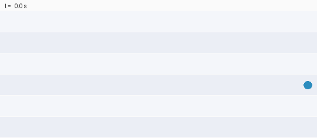
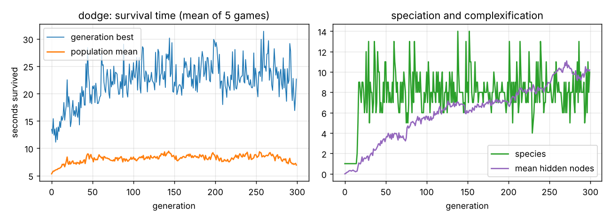
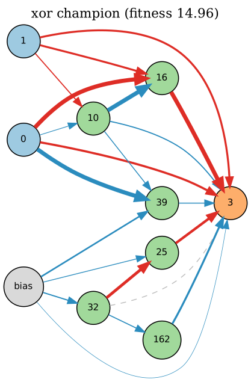
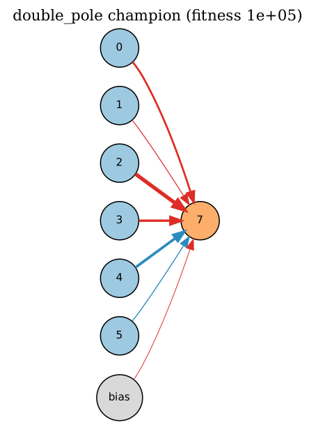
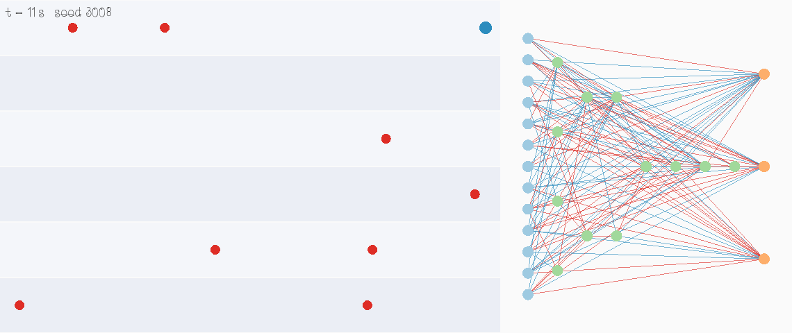

# NEAT in modern C++

[](https://github.com/fekoester/NEAT-Implementation/actions/workflows/ci.yml)

A from-scratch implementation of **NeuroEvolution of Augmenting Topologies** ([Stanley & Miikkulainen, 2002](https://nn.cs.utexas.edu/downloads/papers/stanley.ec02.pdf)).
NEAT evolves both the weights *and* the structure of neural networks, starting from minimal networks and adding nodes and
connections only when they help.

C++17, no dependencies besides the standard library. SFML is optional, for the live viewer. Training is deterministic
per seed and multithreaded.

<p align="center">
  <br>
  <em>An evolved network playing the dodge game in a typical (median) unseen game, 19.7 s. It switches rows to avoid the
  incoming projectiles, which spawn faster and faster.</em>
</p>

## Results

Every number below comes from `neat_train` with the default settings. Repeated runs use seeds 1–100; the result files are
in `results/`.

| task | runs solved | generations | evaluations | hidden nodes | NEAT paper |
|---|---:|---:|---:|---:|---|
| **XOR** | 100 / 100 | 53 ± 35 | 8,009 ± 5,303 | 3.3 ± 1.5 | 100/100, 32 gens, 4,755 ± 2,553 evals, 2.35 hidden |
| **Double-pole balancing** (with velocities, 100k steps) | 100 / 100 | 27 ± 14 | 4,046 ± 2,046 | 1.5 ± 1.4 | 3,600 evals |

- **Double-pole balancing**, the paper's control benchmark, needs about as many evaluations as reported in the paper. On
  average, the champions also balance from 87 % of 100 unseen random starting states (median 98.5 %).
- **XOR** is always solved, but it takes about 1.7× the evaluations of the paper's own implementation, which used
  slightly different mutation details. `configs/xor_paper.cfg` lists the paper's settings.
- **Dodge**: training for 300 generations takes 29 s on 2 cores. Over 50 unseen games, the champion survives **20.8 s on
  average** (3 seeds: 19.6–22.7 s). A hand-written "flee the most threatened row" policy reaches 20.6 s. The game gets
  steadily harder, and no policy reaches the 60 s cap.
- **Single-pole cart-pole** is included as a quick example; even a random minimal network often solves it.
- **Speed**: all 100 XOR runs take 5.5 s in total.

<p align="center">
  <br>
  <em>Dodge training: survival time, number of species (the threshold adapts towards 8) and network growth.</em>
</p>

| evolved XOR network | evolved double-pole controller |
|---|---|
|  |  |

In these drawings, blue connections are positive, red ones negative, line width shows |weight|, and dashed connections
are disabled genes. The double-pole controller needed no hidden node at all, a minimal solution of the kind NEAT's
"start small" principle is designed to find.

## Quick start

```bash
cmake -S . -B build -DCMAKE_BUILD_TYPE=Release
cmake --build build --parallel
ctest --test-dir build                 # unit tests

./build/neat_train --env xor --generations 200 --seed 1 --out runs/xor
./build/neat_train --env double_pole --runs 100 --out runs/dp_benchmark --quiet
./build/neat_train --env dodge --generations 300 --out runs/dodge
./build/neat_play  --env dodge --genome runs/dodge/champion.genome --seed 7 --trace trace.csv
./build/neat_viewer --genome runs/dodge/champion.genome      # needs SFML (apt install libsfml-dev)
dot -Tpng runs/xor/champion.dot -o xor.png                    # draw the network (Graphviz)
```

Each training run writes:
- `stats.csv`: per generation, the best and mean fitness, species, threshold, hidden nodes and connections
- `champion.genome`: a plain-text genome you can reload
- `champion.dot`: a Graphviz drawing of the champion
- `config.txt`: the settings used

With `--runs K`, it also writes `runs.csv` and prints summary statistics. Any setting can be changed with
`--set key=value`, or with `--config file.cfg` using `key = value` lines.



### Use it as a library

```cpp
#include "neat/population.hpp"
#include "neat/network.hpp"

neat::Config cfg;
cfg.num_inputs = 2;
cfg.num_outputs = 1;
cfg.seed = 42;

neat::Population pop(cfg);
auto fitness = [&](const neat::Genome& g, neat::Rng&) {
    auto net = neat::Network::from_genome(g, cfg);
    const double cases[4][3] = {{0, 0, 0}, {0, 1, 1}, {1, 0, 1}, {1, 1, 0}};
    double error = 0;
    for (const auto& c : cases) error += std::abs(net.activate({c[0], c[1]})[0] - c[2]);
    return (4 - error) * (4 - error);
};
pop.run(fitness, 300, [](const neat::GenerationStats& s) { return s.best_fitness > 15.9; });
const neat::Genome& champion = pop.best_ever();
```

The evaluator is called from several threads. Each call gets its own seeded `Rng`, so results do not depend on the
thread count.

## How it works

The implementation follows the paper:

- **Genomes**: node genes plus connection genes with **innovation numbers**. An `InnovationTracker` gives the same
  structural mutation the same innovation number (for connections) or node id (for node splits within a generation).
  This is what allows genomes to be aligned for crossover and speciation.
- **Mutations**:
  - weight perturbation or replacement
  - *add connection*: no duplicates, and no cycles in feed-forward mode
  - *add node*: splits a connection, with the new incoming weight 1 and the outgoing weight equal to the old one
  - *toggle enable*
- **Crossover**: matching genes are inherited at random from either parent, disjoint and excess genes come from the
  fitter parent, and a gene disabled in either parent stays disabled with 75 % probability.
- **Speciation**: δ = c₁·E/N + c₂·D/N + c₃·W̄, compared against a random representative of each species from the previous
  generation. Optionally, the threshold adapts towards a target number of species.
- **Reproduction**:
  - explicit fitness sharing
  - offspring allocated by largest-remainder rounding (the population size is always exact)
  - the top 20 % of each species may reproduce
  - the champion of each species with at least 5 members is copied unchanged
  - 25 % of offspring come from mutation only, and 0.1 % from interspecies mating
  - species that haven't improved for 15 generations are removed, except the top 2
- **Networks**: feed-forward genomes are evaluated in topological order (one call goes from inputs to outputs). Recurrent
  genomes (`feed_forward = false`) advance one step per call. Only enabled connections carry signal.
- **Champion selection** for noisy tasks: each generation's champion is re-scored on a separate validation set of
  games, so the saved champion is the most robust one, not the luckiest.

## Environments

| name | inputs → outputs | fitness |
|---|---|---|
| `xor` | 2 → 1 | (4 − Σ\|error\|)²; solved when all four cases are on the right side of 0.5 |
| `cartpole` | 4 → 1 | steps balanced, up to 2,000, averaged over 3 random starts |
| `double_pole` | 6 → 1 (force) | steps balanced, up to 100,000 (Wieland's equations, RK4, constants of the classic NEAT/ESP setup) |
| `dodge` | 12 → 3 (up / stay / down) | seconds survived, averaged over 5 games (max 60 s). Inputs: per-row proximity of the nearest projectile, plus the player row (one-hot) |

## What changed since the 2017 version

The original code is preserved in [`legacy/`](legacy). It had a number of bugs that kept NEAT from working as
intended:

| 2017 problem | now |
|---|---|
| Didn't compile with GCC/Clang (`void Organism::feedInput(...)` inside the class, `system("cls")`), and had no build system | Portable C++17 with CMake; CI on Linux (GCC, Clang), macOS and Windows |
| Crossover compared each gene only with the other parent's *first* gene, so children were copies of the fitter parent | Genes are aligned by innovation number |
| `connection.enabled != connection.enabled;`: the toggle mutation was a no-op comparison | The flag really flips (there's a test for it) |
| The network ignored `enabled`, so split connections kept carrying signal | Only enabled connections are used |
| `randomConnection + i % size` read out of bounds; `mutateType` had an off-by-one | Bounds-safe, and tested under AddressSanitizer/UBSan |
| Innovation numbers were keyed on per-genome node indices; hidden node ids weren't tracked | Global innovation tracker for connections and node splits |
| Compatibility distance divided by zero without matching genes, and mixed up excess vs. disjoint | Matches the paper's formula; tested |
| Wall-clock game time with rendering always on: machine-dependent fitness, slow training | Fixed 60 Hz time step; headless, deterministic, multithreaded |
| Inputs `x/100 + velocity` mixed position and speed; the selection of the nearest projectiles was broken | Per-row time-to-impact proximity, plus the player row |
| Offspring counts rounded per species (the population size drifted); no elitism or stagnation handling | Exact allocation, elitism, stagnation, survival threshold |

## Layout

```text
include/neat/   config, rng (portable xoshiro256**), genome + innovation tracker, network, population, io
src/            implementation
envs/           xor, cart-pole, double-pole, dodge
apps/           neat_train (CLI), neat_play (replay / record), neat_viewer (SFML, optional)
tests/          doctest unit tests
scripts/        plot_stats.py (training curves), render_dodge.py (GIF from a recorded game)
configs/        example config (paper settings for XOR)
results/        benchmark outputs used in this README
legacy/         the 2017 implementation
```

## License

No license file yet. Add one (e.g. MIT) if you want others to reuse the code.
